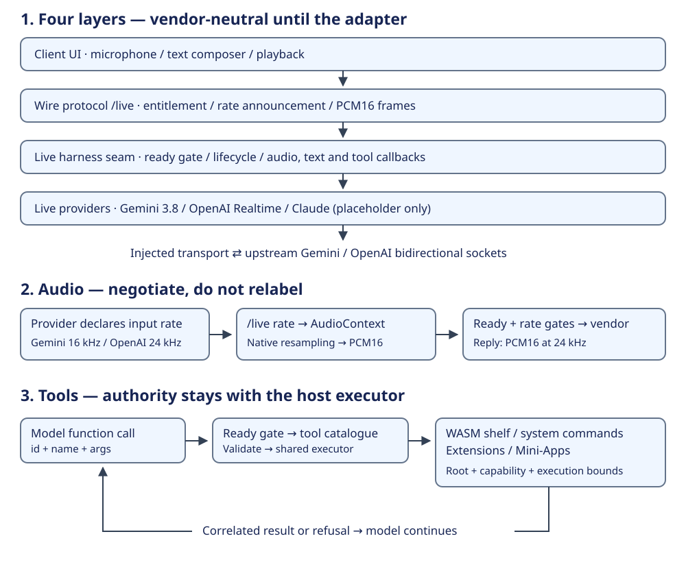

# Voicebox

Voicebox is a real-time, voice-first AI workspace in the browser. Speak naturally with a live multimodal model over low-latency, full-duplex audio while creating and editing files, launching interactive sandboxed Mini-Apps (Web MCP), running digest-pinned WebAssembly tools, and delegating engineering tasks to local or remote coding agents.

---

## Quick Start

### 1. Prerequisites
- **Node.js**: v22.0.0 or higher
- **Browser**: A modern Chromium-based browser (Chrome or Edge) for File System Access API and AudioWorklet support
- **API Key**: Google Gemini (`GEMINI_API_KEY`), OpenAI (`OPENAI_API_KEY`), or Anthropic (`ANTHROPIC_API_KEY`)

### 2. Install & Run
```bash
git clone https://github.com/PaulKinlan/voicebox.git
cd voicebox
npm install
npm start
```
The server starts at `http://localhost:8787` (bound to `127.0.0.1`; override port with `PORT=...`).

### 3. Configure API Keys
You can configure provider keys in either of two ways:
- **In the Browser UI (Recommended)**: Click **Settings (⚙)** in the top bar and paste your Gemini, OpenAI, or Anthropic API key. Keys are saved to the host's `0600` credential store (`GET` / `PUT /api/keys`) and take effect immediately without restarting the server.
- **Via Environment Variables**:
  ```bash
  # Gemini Multimodal Live (default: models/gemini-3.8-live)
  export GEMINI_API_KEY="your-gemini-api-key"

  # OpenAI Realtime (gpt-realtime)
  export OPENAI_API_KEY="your-openai-api-key"

  # Anthropic (for Claude turn resolution and coding agent adapters)
  export ANTHROPIC_API_KEY="your-anthropic-api-key"
  ```

To check installed coding agent harnesses and host diagnostics from the terminal:
```bash
node server.mjs --doctor
```

---

## Using the Interface

1. **Centered Hero Microphone & Composer**:
   - Click the central microphone button (`#mic`) or press `M` to start or stop a live voice session.
   - **Barge-In**: Speak at any time while the assistant is talking to interrupt playback immediately and redirect the conversation. The real-browser regression in `tests/ldxa-barge-in-browser.test.mjs` also holds an echo until after the flush to verify the synthetic provider does not resume playback from a queued response.
   - **Text Composer (`#text-form`)**: Type commands or questions directly when working in quiet environments or testing with the deterministic `script` resolver.
2. **Pop-Over Bubbles (`#sqeh-deck`)**:
   - **Files (`#sqeh-files-bubble`)**: Opens your active workspace file list (`#made-list`) in a compact floating pop-over card. Switch between a local directory (via the browser's File System Access API) or the persistent in-browser OPFS scratchpad.
   - **File Viewer (`#sqeh-reader-bubble` / `#reader`)**: Displays file contents in a floating viewer popover. It also opens automatically when you ask the assistant to *"open \<file\>"* or *"show me \<file\>"*. Includes a **Minimize to Bubble** (`#reader-minimize`) button and an **Open as Mini-App** (`#file-run-app`) action for `.html` files.
   - **Mini-Apps (`#sqeh-actions`)**: Interactive HTML apps and games in your workspace—or created live during conversation—open in a draggable, resizable, full-screen-expandable pop-over window (`#mini-app-container`). Each Mini-App runs inside a sandboxed double-iframe bridge that exposes interactive Web MCP tools directly to the voice assistant. Deleting a Mini-App removes only what it owns: a same-named workspace file is deleted only when the Mini-App's record names it as its own copy, so a colliding page survives. Saving a file as a Mini-App is refused (`mini-app-name-taken`) when the Mini-App already at that slug does not name that file, before anything is written, rather than overwriting it (`voicebox-beads-dvu8`).
   - **Recent Turns (`#sqeh-toggle-history`)**: Opens a floating pop-over bubble (`#session`) displaying recent conversation turns, tool execution timings, and inline file edit chips.
3. **Top Bar Controls**:
   - **Theme Toggle (`#theme-toggle`)**: Switch between Warm Paper (light), Dark, and **System (match device)**. The choice is remembered and applied *before* the page is first painted by `public/theme-boot.js`, so reloading never flashes the wrong scheme first. A browser with JavaScript disabled cannot read that choice but no longer has to: `public/style.css` declares `color-scheme: light dark` with a `light-dark()` palette and no page forces a scheme, so a scriptless load follows the operating system. The two paths differ on purpose — with scripting, nothing stored still means light, because `System` is the opt-in for following the device.
   - **Harnesses**: Inspect and activate installed coding agent harnesses (such as Pi or Claude Code) directly in the UI without setting environment variables.
   - **Environments**: Manage local, fenced sandbox, and paired remote execution environments. Declaring the same host twice keeps one row, and each row shows the origin it points at; a host that is not running is named unreachable with the remedy. The root surface — “Use browser workspace”, “Pick a local folder…”, “Set machine root” and creating a project by name — is owned by `public/components/environment-root-dialog.mjs`; the host still owns the folder picker, OPFS adoption, the active-folder state and the header chip it repaints.
   - **Extensions**: Review extension capability disclosures, approve pending proposals, and inspect the WebAssembly tool shelf.
   - **Settings (⚙)**: Configure voice selection, assistant instructions, audio input/output devices, and provider API keys. `public/settings-ui.mjs` owns the dialog, agent preferences and masked key controls; audio device selection and routing are owned by `public/components/audio-device-controller.mjs` (`voicebox-beads-uei2.6`), while the host retains theme and workspace facts, and the microphone hotkey is owned by `public/components/mic-hotkey-controller.mjs`. The header gear, system-command “open settings” and quick-dock Settings control use the same dialog opener, so each refreshes the displayed device, agent and key states.

---

## Architecture Overview

Voicebox pairs a zero-dependency Node.js gateway (`server.mjs`) and modular browser UI (`public/fused.js`, `public/theme.mjs`, `public/extensions-ui.mjs`, `public/settings-ui.mjs`, `public/components/environment-root-dialog.mjs`, `public/components/changelog-dialog.mjs`, `public/components/mic-hotkey-controller.mjs`, `public/components/sync-toast.mjs`, `public/components/audio-device-controller.mjs`, `public/components/activity-log-ui.mjs`, `public/components/mini-app-surface.mjs`, `public/components/environment-list.mjs`, `public/live-voice.js`) with a pure TypeScript policy core (`core/`). Extension HTTP discovery and decisions are grouped in `lib/routes/extensions.mjs`; the server still owns the authorization checks and bounded JSON body parser.

### Pluggable live-model library

`lib/live-harness.mjs` exposes the gated session and provider registry without starting the UI or server. Gemini offers **3.8 Live** (default), **3.8 Thinking** (2048-token reasoning budget), and **3.8 Flash**; OpenAI Realtime uses the same tool catalogue and executor. Claude live streaming remains a placeholder, separate from coding-agent delegation.

```text
Client UI -> /live wire -> Live harness seam -> Gemini 3.8 / OpenAI providers
                               |                        -> vendor bidi sockets
                               +-> Tool catalogue -> bounded host executor -> result
```



See [Pluggable live models](docs/23-pluggable-live-models.md) for the API, 16/24 kHz rate negotiation, tool roundtrip and verification limits. The [documentation site](https://paulkinlan.github.io/voicebox/) builds from `docs/` on main via `.github/workflows/pages.yml`; feature pushes prepare documentation but do not deploy it.

### 1. Live Voice Gateway & Turn Resolvers (`lib/live-session.mjs`, `lib/resolver.mjs`)
- **Full-Duplex Voice (`/live`)**: Streams 16kHz/24kHz PCM audio between the browser's `pcm-worklet.js` AudioWorklet and upstream providers (`models/gemini-3.8-live` or `gpt-realtime`).
- **Workspace Instructions (`lib/project-instruction.mjs`)**: Automatically discovers the nearest `AGENTS.md` or `AGENT.md` file (up to 32 KiB) in the active workspace and injects it into the live session instruction.
- **Turn Resolution (`POST /api/turn`)**: Text composer and browser dictation requests resolve into structured actions through `lib/resolver.mjs` before executing on the shared server executor.

<!-- BEGIN GENERATED: providers — values below are derived and re-checked; the prose around them is written by a person and is only as true as its last reading -->
**Registered turn resolvers** (`lib/resolver.mjs`): `claude`, `gemini`, `openai`, `script`

* **Registration & Dispatch**: `registerResolver(name, fn)` registers a text turn resolver; `resolveTurn(transcript, provider = "script")` resolves a user transcript into a structured action.
* **Deterministic Script Resolver (`script`)**: Maps common file and tool commands without requiring an external API key (for example, `"create a file called hello.txt with hi"` → `{"verb":"write","name":"hello.txt","content":"hi"}`).
* **Supported Verbs**: `write`, `read`, `list`, `make-tool`, `tool`. Prompts outside the deterministic grammar return an explicit `unresolved` response (for example, `"book me a flight to Lisbon"` → `"the script resolver only knows create/read…"`).
* **Live Voice Providers**: Full-duplex audio providers (`claude`, `gemini`, `openai`) are registered separately via `registerLiveProvider` in `lib/live-session.mjs` and stream audio and tool calls over `/live`.
<!-- END GENERATED: providers -->

<!-- BEGIN GENERATED: live-session — values below are derived and re-checked; the prose around them is written by a person and is only as true as its last reading -->
**Live Voice Providers (`lib/live-session.mjs`)**: `claude` (`(registered, but this check has no capture for it)`), `gemini` (`models/gemini-3.8-live`), `openai` (`gpt-realtime`). The default fallback provider is `gemini` (configurable via `VOICEBOX_LIVE_PROVIDER` or selected per session in the UI Settings dialog).
<!-- END GENERATED: live-session -->

### 2. The Agent Loop & Shared Executor (`server.mjs`, `core/extensions.ts`)
Whether an action originates from a live voice tool call or a typed turn, it runs through a single mediated executor:
Root-scoped CLI execution in `lib/system-tools.mjs` strips inherited Git hook plumbing so Git and child commands operate on the declared workspace rather than the hook's repository.
- **Workspace File Tools**: Root-scoped operations (`read_file`, `write_file`, `list_files`, `delete_file`, `edit_file`, `diff_file`, `grep_files`) enforce strict path containment inside the declared project root.
- **WebAssembly Tool Shelf (`lib/wasm-shelf.mjs`, `lib/wasm-worker.mjs`)**: Executes digest-pinned `.wasm` modules in isolated worker processes with strict memory, stdout (2 MB), and wall-clock (5,000ms) ceilings. See [`docs/20-webassembly-tools.md`](docs/20-webassembly-tools.md).
- **Coding Agent Delegation (`lib/pi-acp.mjs`, `lib/claude-acp.mjs`)**: Delegates complex multi-step coding tasks over the Agent Client Protocol (ACP) to Pi or Claude Code with bounded timeouts and output budgets.
- **Agent Listing (`lib/routes/agents-read.mjs`)**: Exact `GET /api/agents` filters public agent projections and computes admission from the host's current adapter/harness state on each request. Host-owned `POST /api/agents` registration and the loopback auth wall are separate and unchanged.
- **Fleet Discovery (`lib/routes/fleet.mjs`)**: Exact `GET /api/fleet` lists public agent projections, filtered by environment and harness. The host retains `POST /api/fleet/contact` because it forwards the caller's bearer and mints a cross-environment audit token.
- **Sandboxing & Audit Trail (`lib/fence-provider.mjs`, `core/tier-table.ts`)**: Enforces capability boundaries and records every attempt, outcome, and refusal in an append-only JSONL audit log.
- **Work Activity (`lib/routes/activity.mjs`)**: `GET /api/activity` reads the host's ephemeral work log; `DELETE /api/activity` clears that same in-memory array in place so later producer writes remain visible. The global loopback auth wall remains in `server.mjs`.
- **Change Log (`lib/routes/changelog.mjs`)**: `GET /api/changelog` reads and formats recent Git commits using a private HEAD/ref-mtime cache. The room's own Change log dialog — the lazy fetch, the commit-card renderer and the conventional-commit badges — is owned by `public/components/changelog-dialog.mjs`. It retains the existing uncached behavior for worktrees with a `.git` file; the host still owns auth and adjacent health routes.
- **Tool Catalogue (`lib/routes/tool-catalog.mjs`)**: Exact `GET /api/tools` lists or searches (`?q=`, `?kind=`, `?limit=`) native, extension, system, script, mini-app and harness capabilities, combining the mini-app registry with the harness inventory. The host still owns the `lib/tool-index.mjs` functions, the registries, `ROOT` and the loopback auth wall, and hands the active root over as a **live accessor** so a root declared after startup is listed from immediately — a snapshot would report the boot-time root forever.
- **Gemini Media (`lib/routes/gemini-media.mjs`)**: Exact `GET /api/gemini/capabilities` plus `POST /api/gemini/image`, `/video` and `/embed`, moved out of `server.mjs` with their refusal shapes and their order intact — a non-JSON body is refused before any provider is reached. The external providers are injected, so the focused seam test drives every branch, refusals included, with fakes and a fetch spy that fails the test if anything touches the network. The host keeps the providers, the body cap, `resolveActive` and the loopback auth wall, and the image route reads the active root live so a machine root declared after startup is honoured.

<!-- BEGIN GENERATED: loop — values below are derived and re-checked; the prose around them is written by a person and is only as true as its last reading -->
The table below traces a complete turn executed against a temporary workspace during documentation generation:

| Step | Stage | Mechanism | Verified Output |
|---|---|---|---|
| **1. Turn Request** | Client submits transcript | `POST /api/turn { transcript }` | `"create a file called hello.txt with hi"` |
| **2. Turn Resolution** | Resolver parses transcript into an action | `resolveTurn(transcript, "script")` in `lib/resolver.mjs` | `{"verb":"write","name":"hello.txt","content":"hi"}` |
| **3. Action Execution** | Executor runs action inside the active root | `execute(action)` in `server.mjs` (`POST /api/root`) | `wrote hello.txt (2 bytes)` (`root.kind: "machine"`) |
| **4. Turn Response** | Server returns structured result to client | `{ transcript, action, result }` | `ok: true`, `logged: 2` |
| **5. Audit Trail** | Append-only log records **2 entries** (`attempt`/`attempted` → `allow`/`writes-inside`, linking outcome to attempt sequence) and 1 entry for pre-flight refusal | `<root>/.audit/<writer>.jsonl` (`core/shared-log.ts`), `GET /api/audit` | seq 1 `attempt`, seq 2 `allow`; refusal: seq 3 `refuse`/`outside-root` |

**Boundary & Admission Guarantees (Verified Against Live Server):**
* **Undeclared Root Refusal**: Running the turn before declaring a project root returns `refused: "root-not-declared"` (`logged: null`). Once declared via `POST /api/root` (`ok: true`, `reachableFromThisProcess: true`), the turn succeeds.
* **Path Containment**: Attempting to read outside the workspace (`"read .."`) is refused with `refused: "outside-root"` and logged at audit sequence `3`.
* **Extension Lifecycle (`make-tool` → `admit` → `tool`)**:
  1. **Propose**: `"create a tool called peek that lists files"` resolves to `make-tool` and writes a pending descriptor (`proposed tool 'peek-tool'`, state `pending`) under `proposals/` without loading code.
  2. **Inspect Plan**: `GET /api/extensions/proposals/peek-tool/plan` previews the admission verdict (`admitted`; enforced: read via `host-primitive-scope`).
  3. **Host Admission**: `POST /api/extensions/admit` with `x-voicebox-host-token` admits the descriptor (`admitted`); requests without the host token fail with HTTP 403 (`host-token-required`).
  4. **Invoke**: `"run the tool peek"` dispatches `tool` → `callTool("peek")` in `lib/extensions.mjs` (`ok: true`, files `["hello.txt"]`).
  5. **Inventory**: `GET /api/extensions` lists `peek-tool` with declared capabilities `[read]`, enforcement `{"read":"host-primitive-scope"}`, and tools `[peek]`.

**Unified Workspace Root**: Admitted file extensions operate on the active project root (`["hello.txt"]`).
<!-- END GENERATED: loop -->

<!-- BEGIN GENERATED: tool-path — values below are derived and re-checked; the prose around them is written by a person and is only as true as its last reading -->
User input reaches the shared action executor through three paths:

| Input Path | Active | Transport | Execution Pipeline |
|---|---|---|---|
| **Text Composer** | Yes | `public/fused.js` → `POST /api/turn` | `resolveTurn()` (`lib/resolver.mjs`, default `script`) → `execute()` (`server.mjs`) → `callTool()` (`lib/extensions.mjs`) |
| **Browser Dictation** (`SpeechRecognition`) | Yes | `public/fused.js` → `POST /api/turn` | Same pipeline as Text Composer |
| **Live Voice Audio** | Audio: Yes; Tools: **Yes** | `public/live-voice.js` → `/live` → `lib/live-session.mjs` | Provider tool call → `commandToAction()` → `execute()` → correlated tool response + `{type:"tool"}` UI notification |

**Live Session Tool Declarations**: `claude` declares: (not captured); `gemini` declares: `list_extensions`, `call_extension`, `propose_extension`, `write_file`, `read_file`, `list_files`, `delete_file`, `edit_file`, `diff_file`, `grep_files`, `list_agents`, `delegate_task`, `contact_agent`, `launch_mini_app`, `git_status`, `git_diff`, `git_log`, `inspect_environment`, `undo_last_action`, `list_tools`, `search_tools`, `run_command`, `open_workspace`; `openai` declares: `list_extensions`, `call_extension`, `propose_extension`, `write_file`, `read_file`, `list_files`, `delete_file`, `edit_file`, `diff_file`, `grep_files`, `list_agents`, `delegate_task`, `contact_agent`, `launch_mini_app`, `git_status`, `git_diff`, `git_log`, `inspect_environment`, `undo_last_action`, `list_tools`, `search_tools`, `run_command`, `open_workspace`.

**Script Resolver Sample Utterances**: `"create a file called hello.txt with hi"` → `write`, `"read hello.txt"` → `read`, `"list files"` → `list`, `"create a tool called clock that tells the time"` → `make-tool`, `"run the tool clock"` → `tool`.
<!-- END GENERATED: tool-path -->

<!-- BEGIN GENERATED: tools — values below are derived and re-checked; the prose around them is written by a person and is only as true as its last reading -->
**Built-In Extension Primitives** (`6` closed primitives in `core/extensions.ts`; extensions parameterize primitives as pure JSON descriptors rather than executing arbitrary model-authored code):

| Primitive | Capability Required | Host-Mediated Interface |
|---|---|---|
| `now` | — | Returns current host timestamp |
| `read-file` | read | a root-scoped read function: paths resolve inside the project root or refuse |
| `write-file` | write | a root-scoped write function: paths resolve inside the project root, writes are reported and revertible |
| `list-files` | read | a root-scoped read function: paths resolve inside the project root or refuse |
| `http-get` | network | a mediated fetch: hosts outside bounds.hosts are refused by name — INCLUDING across redirects, every hop charged to bounds.maxRequests — and the audit records the URL that actually served the bytes |
| `wasm` | — | Isolated WebAssembly module verified by SHA-256 digest at admission and invocation under strict host memory and timeout ceilings |

**Capabilities Prohibited on `machine` Placement**:
* exec — absent: no mechanism on this placement bounds a spawned child: --allow-run bounds which binary, never what it can do, and a child does not inherit the parent's flags. Admission requires a container that bounds the child.
* eval — absent: eval is not a tool path (design §1.7): the evaluator bypasses whatever the substrate would otherwise enforce.
* import — absent: no import boundary on this placement: dynamic import executes fetched code with no flags by default.

**Extension Catalogue (`catalogue/*.json`, 4 descriptors)**:

| Extension ID | Tools | Declared Capabilities | Bounds | Admission Verdict |
|---|---|---|---|---|
| `brave-search` | `brave_search` → `http-get` | network | hosts: api.search.brave.com; maxRequests: 20 | admitted — network via `mediated-fetch` |
| `mcp-server-local` | `mcp_list_tools` → `process` | exec | command: npx -y @modelcontextprotocol/server-filesystem /tmp | **refused** `exec-absent` |
| `mcp-server-remote` | `mcp_remote_list_tools` → `http-get` | network | hosts: mcp.example.com; maxRequests: 20 | admitted — network via `mediated-fetch` |
| `web-search` | `web_search` → `http-get` | network | hosts: api.duckduckgo.com; maxRequests: 5 | admitted — network via `mediated-fetch` |

**Named Refusal Codes by Subsystem**:
* **Extension admission gate (`core/extensions.ts`)**: `absent-capability`, `bad-tool-name`, `capability-unmediated`, `duplicate-tool`, `eval-not-a-tool-path`, `exec-absent`, `network-unbounded`, `no-tools`, `under-declared`, `unknown-capability`, `unknown-primitive`, `unsupported-abi`
* **Mini-app store (`lib/mini-app-store.mjs`)**: `mini-app-name-taken`, `mini-app-not-found`, `missing-html`, `outside-root`
* **HTTP routes and workspace root boundary (`server.mjs`, `lib/routes/workspace.mjs`, `lib/routes/extensions.mjs`, `lib/routes/presence.mjs`, `core/root.ts`, `browser/acts.ts`)**: `adapter-not-configured`, `approval-invalid-id`, `approval-json-required`, `audit-unreadable`, `bad-answer`, `bad-json`, `bad-request`, `bearer-refused`, `body-too-large`, `bounds-invalid`, `cannot-delete-directory`, `cannot-delete-local`, `cross-environment-unauthorized`, `dotfile-refused`, `environment-not-paired`, `environment-unknown`, `environment-unreachable`, `exec-threw`, `executor-unavailable`, `extension-not-admitted`, `git-failed`, `host-token-refused`, `host-token-required`, `invalid-task`, `loopback-auth-disabled`, `loopback-unauthenticated`, `mini-app-timeout`, `mini-app-unreachable`, `missing-argument`, `missing-content`, `no-project`, `not-a-directory`, `not-a-git-repo`, `not-found`, `not-supported-in-browser`, `nothing-to-undo`, `outside-root`, `pairing-revoked`, `path-missing`, `pattern-not-found`, `pattern-not-unique`, `probe-failed`, `provider-not-configured`, `root-not-mine`, `root-not-reachable-from-here`, `root-unreachable`, `server-error`, `task-root-unavailable`, `unauthenticated-call`, `undo-failed`, `unknown-command`, `unknown-environment`, `unknown-mini-app-tool`, `unknown-root-kind`, `unknown-verb`, `unreadable`, `unsupported-content-type`, `write-error`
* **Extension runtime (`lib/extensions.mjs`)**: `approval-audit-unwritable`, `approval-no-proposal`, `approval-plan-changed`, `approval-unavailable`, `bad-descriptor`, `bad-redirect`, `bad-tool-name`, `bounds-invalid`, `descriptor-missing`, `extension-not-admitted`, `fetch-failed`, `gate-refused-at-load`, `invalid-id`, `missing-description`, `missing-name`, `network-unbounded`, `no-tools`, `over-budget`, `params-invalid`, `params-unknown-tool`, `redirect-host-not-allowed`, `redirect-without-location`, `too-many-redirects`, `unknown-primitive`, `unreadable`
* **Task delegation and lifecycle (`core/tasks.ts`, `lib/tasks.mjs`)**: `agent-environment-mismatch`, `agent-not-configured`, `agent-required`, `executor-unavailable`, `invalid-task`, `invalid-task-address`, `invalid-task-context`, `task-audit-unavailable`, `task-authority-field`, `task-call-id-conflict`, `task-call-id-required`, `task-cancelled`, `task-capacity-exhausted`, `task-context-unavailable`, `task-deadline`, `task-environment-changed`, `task-environment-unverified`, `task-input-over-budget`, `task-invalid-result`, `task-not-found`, `task-not-running`, `task-output-over-budget`, `task-owner-mismatch`, `task-owner-unconfirmed`, `task-owner-unverified`, `task-persistence-failed`, `task-root-replaced`, `task-root-unavailable`, `unbounded-executor`, `unknown-tool`, `unsupported-runtime-capability`

**Runtime Inspection & Admission Endpoints**:
* `GET /api/extensions`: Returns `{ placement, extensions, proposals, present, failedLoads, catalogueCount }` (placement: `machine`, catalogueCount: 4).
* `GET /api/extensions/catalogue`: Previews admission verdicts for all catalogue descriptors.
* `GET /api/extensions/{proposals|catalogue}/<id>/plan`: Returns capability and enforcement disclosure prior to admission.
* `GET /api/probe`: Runs `tools/sandbox-probe.mjs` and returns an observed environment report (HTTP 200; sections: `identity`, `sandboxHints`, `filesystem`, `limits`, `tools`, `network`).
* `POST /api/extensions/admit`: Requires `x-voicebox-host-token` (unauthenticated requests fail with HTTP 403 `host-token-required`).
<!-- END GENERATED: tools -->

---

## Configuration Reference

<!-- BEGIN GENERATED: config — values below are derived and re-checked; the prose around them is written by a person and is only as true as its last reading -->
Environment variables read by the server and runtime libraries:

| Variable | Read In | Description |
|---|---|---|
| `ANTHROPIC_API_KEY` | `lib/live-providers/claude.mjs`, `lib/pi-acp.mjs`, `lib/resolver.mjs`, `server.mjs` | Anthropic API key used by the `claude` resolver/provider and forwarded to the `pi-acp` adapter as a fallback when no store credential exists (can also be configured in the UI Settings dialog). |
| `BRAVE_API_KEY` | `lib/extensions.mjs` | Brave Search API subscription token used by `http-get` extensions targeting `api.search.brave.com`. |
| `FORCE_COLOR` | `lib/logger.mjs` | Terminal color override (`0` disables ANSI colors in `lib/logger.mjs`; non-zero enables them when stdout is not a TTY). |
| `GEMINI_API_KEY` | `lib/gemini-models.mjs`, `lib/live-providers/gemini.mjs`, `lib/resolver.mjs`, `server.mjs` | Google Gemini API key for Gemini Live voice sessions and the `gemini` text turn resolver (can also be configured in the UI Settings dialog). |
| `LIVE_PROVIDER` | `lib/live-session.mjs`, `server.mjs` | Deprecated alias for `VOICEBOX_LIVE_PROVIDER`, retained for backward compatibility. |
| `NODE_DISABLE_COLORS` | `lib/logger.mjs` | Node.js built-in flag that disables ANSI terminal colors alongside `NO_COLOR`. |
| `NO_COLOR` | `lib/logger.mjs` | Disables ANSI color sequences in `lib/logger.mjs` when set to a non-empty value. |
| `OPENAI_API_KEY` | `lib/live-providers/openai.mjs`, `lib/resolver.mjs`, `server.mjs` | OpenAI API key for OpenAI Realtime voice sessions and the `openai` text turn resolver (can also be configured in the UI Settings dialog). |
| `PATH` | `lib/claude-acp.mjs`, `lib/tool-index.mjs` | System executable search path, also inherited by task-adapter child processes. |
| `PORT` | `server.mjs` | HTTP server port bound on `127.0.0.1` (default `8787`). |
| `VOICEBOX_ACP_ADAPTER` | `lib/pi-acp.mjs` | Path or command override for the `pi-acp` stdio adapter binary in `lib/pi-acp.mjs`. |
| `VOICEBOX_ACP_PI` | `lib/pi-acp.mjs` | Path or command override for the `pi` coding agent CLI used by `lib/pi-acp.mjs`. |
| `VOICEBOX_BIND_DEADLINE_MS` | `server.mjs` | Maximum duration in milliseconds to retry binding the server port before failing. |
| `VOICEBOX_BIND_RETRY_MS` | `server.mjs` | Interval in milliseconds between port bind retries at startup. |
| `VOICEBOX_CLAUDE_CLI` | `lib/claude-acp.mjs` | Path override for the Claude Code CLI executable (`CLAUDE_CODE_EXECUTABLE`) used by `lib/claude-acp.mjs`. |
| `VOICEBOX_CLAUDE_KEEP_API_KEY` | `lib/claude-acp.mjs` | Set to `1` to retain `ANTHROPIC_API_KEY` in the Claude Code adapter child environment (omitted by default so CLI login takes precedence). |
| `VOICEBOX_ENABLE_STUB_PROVIDER` | `server.mjs` | Set to `1` to register the key-free `stub` live voice provider for local audio testing. |
| `VOICEBOX_EXTENSIONS_DIR` | `lib/state-dirs.mjs` | Host state directory storing admitted extensions, `.host-token`, `.ledger.jsonl`, `.pairings.json`, `.api-keys.json`, and `.harness-settings.json` (mode `0600`). |
| `VOICEBOX_HARNESS` | `server.mjs` | Default host coding agent harness (`pi` or `claude`; can also be switched at runtime in the Harnesses UI dialog). |
| `VOICEBOX_HELLO_BOUND_MS` | `server.mjs` | Timeout in milliseconds to receive an authentication `hello` frame on `/channel` or `/live` (default `5000`). |
| `VOICEBOX_INSTANCE` | `server.mjs` | Writer identifier recorded in the active workspace's `.audit/<writer>.jsonl` log (default `machine`). |
| `VOICEBOX_LIVE_PROVIDER` | `lib/live-session.mjs`, `server.mjs` | Fallback live voice provider (`gemini`, `openai`, or `claude`) when the client session does not specify one. |
| `VOICEBOX_LOOPBACK_AUTH` | `server.mjs` | Set to `1` to require a single-use bootstrap ticket (`?bootstrap=<ticket>`) and `HttpOnly` session cookie for local browser access. One ticket is minted at startup, and its startup text names the host it must be opened on: a cookie is scoped to the host that redeemed it, so a `127.0.0.1:8787` ticket opened from a `localhost:5173` page leaves every `/api` call on that page answering `401` (open the same ticket on `localhost:5173` when that is the dev front you browse). Redemption answers `303` to the plain route with the ticket removed, so the first refresh is authenticated rather than a re-used-ticket `401`. **Default off** (accepted testing posture): with the gate off, unauthenticated loopback clients — including browser-originated requests — can reach state-mutating routes such as active-workspace writes, so the server prints a startup warning naming the exposure and this remedy (see `docs/18-loopback-session-auth.md`). |
| `VOICEBOX_OPENAI_INPUT_TRANSCRIPTION` | `lib/live-providers/openai.mjs` | Set to `1` to enable `gpt-4o-mini-transcribe` input audio transcription in the OpenAI Realtime session handshake. |
| `VOICEBOX_PROVIDER` | `server.mjs` | Deprecated alias for `VOICEBOX_RESOLVER`, retained for backward compatibility. |
| `VOICEBOX_RESOLVER` | `server.mjs` | Default text turn resolver used by `POST /api/turn` (`script`, `gemini`, `openai`, or `claude`; default `script`). |
| `VOICEBOX_SANDBOX_HOMES` | `lib/state-dirs.mjs` | Base directory for fenced sandbox home directories (default `~/sandbox-homes/<key>`, located outside `/tmp` for `PrivateTmp` compatibility). |
| `VOICEBOX_WASM_SHELF_DIR` | `lib/state-dirs.mjs` | Directory containing the digest-pinned WebAssembly tool shelf (`manifest.json` and `.wasm` binaries; default `~/.isocan/modules/wasm-tools`). |
| `VOICEBOX_WORKSPACE` | `lib/state-dirs.mjs` | Declares an active machine project root at startup and stores extension proposals (`proposals/`) and extension audit logs (`audit.jsonl`). |
<!-- END GENERATED: config -->

### Loopback Security Posture (default: unauthenticated — local testing only)

- **Default.** `VOICEBOX_LOOPBACK_AUTH` not `1` → the loopback session gate is OFF (owner-accepted testing posture). The server prints a startup warning naming the exposure and the remedy.
- **Impact.** Any unauthenticated loopback client can reach state-mutating routes: writing files into the **active workspace** and registering environments — and the state-mutating surface includes a command-execution verb. A web page the operator merely visits can cause the browser to send such requests to `127.0.0.1`; the server acts even though the response is not readable cross-origin.
- **Which browser-originated requests act.** Cross-origin *simple* POSTs — the shapes a browser sends without a CORS preflight, which include plain form submissions — reach the routes and act. A JSON-content-type request triggers a preflight first, which the server answers `404`, so nothing acts on that path.
- **Remedy (verified).** `VOICEBOX_LOOPBACK_AUTH=1` requires a token: the one-time bootstrap URL printed at startup redeems into an `HttpOnly` session cookie, and the redemption answers `303` to the plain route with the ticket removed — so the refresh that follows a launch is authenticated rather than a re-used-ticket `401`. The cookie is scoped to the host that redeemed it, so the startup text names the host you must open the ticket on (`localhost:5173` when the dev front is the page you browse), and the `401` a dev-front request gets names that front and the same remedy. Verified behaviour: unauthenticated HTTP requests are refused with `401` (`loopback-unauthenticated`) and WebSocket upgrades refuse under their own names, while `GET /api/health` stays `200` — pinned by `tests/loopback-auth.test.mjs`. A missing session on the dev front leaves the health indicator up and gives an origin-specific bootstrap remedy instead of an offline toast; browser proof is `tests/health-auth-browser.test.mjs`.
- **Staged Content-Security-Policy (reported, not enforced).** The room, `help.html`, `changelog.html`, `environment.html` and `harnesses.html` are served with `Content-Security-Policy-Report-Only` carrying the same policy `index.html` already enforces in its meta tag, so nothing is blocked and no browser behaviour changes. There is no report endpoint: violations appear in the console and in the page's `securitypolicyviolation` event. The header is keyed on the RESOLVED FILE rather than the requested URL, so `/help.html` is covered however it is spelled — including `/%68elp.html` and `/help.html/`, which reached the same document with no policy at all before this was measured. The mini-app pages under `/apps`, the `mini-app-bridge.html` host, static assets and `/api` routes are deliberately not covered. Enforcing the policy is a later, separate change, and the refactor it depended on is done: as of `voicebox-beads-xggy.3` there are **no** inline blocks left to extract — `environment.html`'s stylesheet is `public/environment.css` and its single inline style attribute is a rule in that file. `environment.html` also declares `color-scheme` in a head `<meta>`, which the browser uses for surfaces it draws rather than for the page's own content. Measured on both OS schemes it does not change the page's first painted frame — the stylesheet already supplies the scheme and the ground — and with the stylesheet held, the UA's `Canvas` resolves dark with it and light without it. That is the one surface measured; scrollbars and the caret share the mechanism and were not driven, so they are not claimed. A preventive hint, not a fix for a flash. Scripts are now all external: `help.html`'s search filter is `public/help-search.js`, and `environment.html`'s two handler scripts are `public/environment-root.js` (the root declaration) and `public/environment-dialogs.js` (the create-project opener), and its stylesheet is `public/environment.css` — the last two loaded **without** `defer` on purpose, so a click on "Declare this folder" or on "Create a project" can never land before a listener exists (a click, unlike a search value, cannot be re-applied on attach).
- **Recommendation.** Run with `VOICEBOX_LOOPBACK_AUTH=1` outside local testing; the gate-off default exists for the raw command-line workflow.
- **`public/environment.css` (voicebox-beads-xggy.3).** The Environment page's stylesheet, extracted from its inline `<style>` block so the page needs no `style-src` exception: the 80 original rules moved verbatim and in the same order, and the file adds a provenance header comment plus two rules: the `min-width` rule that replaced an inline style attribute, and
`::placeholder` using `--muted` (voicebox-beads-sv2n, widened to all six of the page's placeholder elements by
voicebox-beads-yd08), which lifts them from the user agent's grey — 4.34:1 light, 3.87:1 dark, under the 4.5:1 floor —
to 5.76:1 and 6.45:1. Its 11 `light-dark()` colour tokens are a palette of their own, separate from `style.css`'s; the browser test pins each pair twice — the exact declared text, and the colour it resolves to in both schemes — so a palette change has to be deliberate rather than something a relocation carries in (voicebox-beads-h1oo).
- **`public/style.css` composer placeholder contrast (voicebox-beads-8wm8).** The room composer's field stays deliberately quieter than typed text, so its placeholder is a translucent mix of `--muted`. At 62% it composited to only 2.68:1 light / 3.46:1 dark; it is now 90%, chosen for headroom rather than as the bare minimum — 88% is the bare clearing candidate at 4.54:1 light / 5.61:1 dark, only 0.04 above the floor in light and so inside rendering variance — alpha 0.902, measuring 4.81:1 light and 5.87:1 dark against typed text at 14.91:1 and 17.11:1. Measured by injecting the exact declaration into a disposable browser and reading composited pixels. `tests/placeholder-contrast-browser.test.mjs` holds the percentage, the composited ratio in both themes, the sub-1 alpha, and the margin below typed text, with a non-empty enumeration guard.
- **`public/style.css` room and Help placeholder contrast (voicebox-beads-0q5c).** Those pages drew placeholder text from the user agent's grey — 4.45:1 light, 4.16:1 dark, and 4.19:1 / 3.17:1 on the two transcript fields — under the 4.5:1 floor. `:where(.room, .settings-form, .help-page) :is(input, textarea)::placeholder` now draws it from `--muted` with an explicit `opacity: 1` — the same statement `.list-tools input::placeholder` already carries — measuring 5.91:1 light and 7.47:1 dark. The `:where()` is load-bearing, not stylistic: a plain container rule has the SAME specificity as `.composer input::placeholder` (one class plus one type, since `::placeholder` counts as a type), so it would win on source order and flatten the composer's deliberate alpha composite — while `:where()` contributes zero specificity and can only fill the gap the user agent leaves. `tests/placeholder-contrast-browser.test.mjs` measures every opaque placeholder field in stored light and stored dark, and holds the composer to its own separate rule rather than to this one — that field is deliberately translucent, and its percentage is covered by the `voicebox-beads-8wm8` bullet above.
- **`public/style.css` type scale and 12px readability floor (voicebox-beads-3674).** Defines a consistent `--text-*` type scale on `:root` (`--text-xs: 0.75rem` through `--text-2xl: 1.25rem`) with an enforced 0.75rem (12px) floor for all secondary text, badges, hotkey indicators, and timestamps across desktop and responsive mobile layouts. Every sub-12px declaration in the four surfaces at `a26fb12` — 43 of them: 28 `font-size` literals and four `font:` shorthands in `public/style.css` (including `.mic-hotkey-badge`, `.sqeh-dock-label`, `.sqeh-action`, `.harness-badge`), and 11 across `public/apps/agent-monitor.html`, `public/apps/landing-inspector.html` and `designs/prototype.html` — is lifted to `var(--text-xs)` (0.75rem / 12px), and the Document-PiP window's `.pip-task-chip` moves off its own `11px` in the same pass. The floor is pinned in two tiers: `tests/type-scale-tokens.test.mjs` reads the declarations with no browser — comments stripped, the `font:` shorthand read past any style or weight (`font: 600 11px/1.4 …` counts), read as declaration text rather than one line at a time and case-folded (`font-size:` with its value on the next line and `FONT-SIZE:` both count — voicebox-beads-jlfq), across every `public/*.css`, every page under `public/`, `designs/prototype.html` and `public/pip-mic.mjs`, the one module that injects a stylesheet of its own — so the fast gate refuses a reintroduced sub-12px size instead of waiting for the browser tier. It resolves sizes carried by custom properties in every scope, so a scoped override of a pinned token and a brand-new token are refused too, naming the declaration that set the size rather than every use of it; and a size it cannot read at all (an unknown `var()` with no fallback, or a unit it cannot convert) is refused rather than passed, because answering "fine" to a size it could not see is the defect the check exists to prevent (voicebox-beads-94of). `tests/type-scale.test.mjs` measures computed sizes in a real Chromium — desktop, a 375px mobile viewport, the agent monitor, the landing inspector and the prototype — and proves the lifted rules are `rem` by doubling the root font size and watching them grow with it. The one row that did not survive that doubling, the waiting-branches count badge, whose fixed `height: 18px` box could not hold 24px text, now carries `min-height` instead.
- **`public/style.css` `.sr-only` overflow clip (voicebox-beads-dche).** Clips the room's `.sr-only` labels with `overflow: clip` instead of `overflow: hidden`, removing unintended scroll container behaviour (6 of the 18 labels present when it was measured were scroll containers — `scrollLeft = 999` moved to 64 — and every label now measures 0) while keeping their accessible names intact in the accessibility tree. The count is deliberately not pinned: a toolbar button added on `main` took it from 18 to 19, and the browser test carries a control arm that proves the probe still detects an `overflow: hidden` 1px box, so a room of zero is a measurement rather than a broken detector.

- **Built-in mini-app script externalization (`voicebox-beads-xggy.4`).** The three built-in mini-apps (`public/apps/agent-monitor.html`, `public/apps/landing-inspector.html`, and `public/apps/live-vision-studio.html`) load their scripts from external modules (`public/apps/agent-monitor.js`, `public/apps/landing-inspector.js`, and `public/apps/live-vision-studio.js`) with zero inline `<script>` blocks, audited by `tests/csp-report-only.test.mjs`.
- **Room UI & Route Modules (`voicebox-beads-8kfa`, `voicebox-beads-2mi8`, `voicebox-beads-7z2y`, `voicebox-beads-r9hv.1`, `voicebox-beads-gnf2`, `voicebox-beads-djp3`, `voicebox-beads-uei2.1`, `voicebox-beads-pcyo`, `voicebox-beads-uei2.4`, `voicebox-beads-uei2.5`, `voicebox-beads-uei2.6`, `voicebox-beads-uei2.2`, `voicebox-beads-uei2.7`).** Candidate branch inspection and landing (`lib/routes/branches.mjs`, `public/branch-landing-ui.mjs`), harness inventory and configuration (`lib/routes/harnesses.mjs`), in-browser system diagnostics (`lib/routes/doctor.mjs`), multi-participant presence and floor control (`public/presence-ui.mjs`), off-main-thread vision frame encoding (`public/vision-frame-encoder.mjs`), live visual grounding callouts (`public/vision-grounding.mjs`), audio meters (`public/audio-meters.mjs`), and Document Picture-in-Picture companion stats (`public/pip-mic.mjs`), and the configurable microphone hotkey (`public/components/mic-hotkey-controller.mjs`), and the revision-mismatch toast and build stamp (`public/components/sync-toast.mjs`), and the audio device selector and its routing (`public/components/audio-device-controller.mjs`), and the work activity log and project-change flash (`public/components/activity-log-ui.mjs`), and the interactive mini-app surface and its sandboxed-app bridge (`public/components/mini-app-surface.mjs`) are modularized and covered by dedicated unit tests.

Full gate documentation: [`docs/18-loopback-session-auth.md`](docs/18-loopback-session-auth.md).

---

## Documentation & Testing

### Documentation Index
See [`docs/README.md`](docs/README.md) for the complete guide to Voicebox's architecture, security model, sandboxing, wire protocol, Mini-Apps, and WebAssembly tools.

### Verification & Quality Gates
- **Scoped Tests (`npm run test:changed`)**: Runs only the unit and integration tests covering files modified since `origin/main`.
- **Unit Test Suite (`npm run test:unit`)**: Runs the fast concurrent unit test suite across `core/`, `lib/`, and `browser/`.
- **Full Test Suite (`npm test`)**: Runs the unit suite, server integration tests, and browser CDP tests. The phantom-turn browser guard waits for the app's actual submit listener before asserting zero page-load turns, then requires exactly one user-submitted `/api/turn` request through network and host ingress; a blocked-module control proves the guard cannot pass on an unwired form.
- **Acceptance Harness (`npm run accept`)**: Verifies the live served application end-to-end in headless Chromium.
- **Documentation Sync (`npm run docs:write` / `npm run docs:check`)**: Regenerates and verifies the live-probed documentation blocks in `README.md` and `docs/07-architecture.md`.
