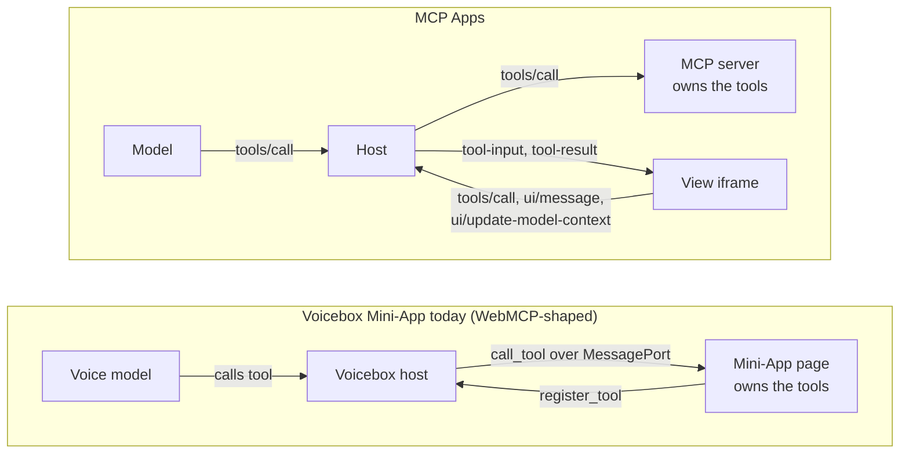

# Mini-Apps, WebMCP and MCP Apps: comparison and recommendation

Status: proposal for decision (voicebox-beads-cwx5.12). Written 2026-11-12.

Voicebox Mini-Apps are interactive HTML pages that the voice assistant can drive through tools. Two public standards now cover neighbouring ground: **WebMCP** (a page registers tools for an agent) and **MCP Apps** (an MCP server ships a UI that a host renders). This page compares all three and recommends what Voicebox should do before launch.

## The short answer

Mini-Apps are a **WebMCP-shaped** system, not an MCP Apps-shaped one. The Mini-App itself owns the tools and the model calls into the page. In MCP Apps the server owns the tools and the page is a view onto them. These are opposite directions, so "should Mini-Apps be MCP Apps?" has two different answers:

1. **Authoring API: align with WebMCP.** Rename the SDK surface to match the WebMCP draft so a Mini-App is simply a web page that uses the standard API. This is a small change with a large payoff.
2. **Hosting protocol: adopt MCP Apps as an additional format, not a replacement.** Teach the Mini-App surface to render `ui://` resources from MCP servers. Voicebox already has the hard part, the double-iframe sandbox.

## Who owns the tools

## Side by side

| | Voicebox Mini-Apps | WebMCP (draft, Chrome origin trial) | MCP Apps (spec 2026-01-26) |
|---|---|---|---|
| What an app is | An `.html` file on the host shelf or in the workspace | Any web page | A `ui://` resource served by an MCP server, MIME `text/html;profile=mcp-app` |
| Who defines tools | The page | The page | The server. A view may only call them |
| Registration API | `window.webMcp.registerTool({name, description, parameters, execute})` then `webMcp.ready()` | `document.modelContext.registerTool({name, description, inputSchema, execute, annotations}, {signal})` | Server `tools/list`, tool carries `_meta.ui.resourceUri` |
| Unregistering | Not supported; tools live until reload | Abort the `signal` | Server `listChanged` |
| Tool result | Any JSON value, 64 KiB cap | A string | MCP content and `structuredContent` |
| Schema dialect | Strict allowlisted subset of JSON Schema, max 16 tools | JSON Schema | JSON Schema |
| Transport | Custom messages over a private `MessagePort` (`register_tool`, `call_tool`, `tool_result`) | Browser-internal | JSON-RPC over `postMessage` (`ui/initialize`, `ui/notifications/tool-input`, `tools/call`, ...) |
| Sandbox | Same-origin bridge iframe wrapping an inner `sandbox="allow-scripts"` opaque-origin iframe | The page's own origin | Web hosts must use a sandbox proxy iframe on a different origin wrapping the view |
| Network policy | No enforced CSP on the inner frame; a same-origin fetch relay to host `/api` | Normal page rules | Declared per resource: `_meta.ui.csp.connectDomains`, `resourceDomains`; default deny |
| Device permissions | `allow="autoplay"` only | Normal page rules | Declared: camera, microphone, geolocation, clipboardWrite |
| App talks to the model | No. The app can only answer tool calls | No | Yes: `ui/message` and `ui/update-model-context` |
| Host pushes data to the app | Only as tool-call arguments | Only as tool-call arguments | Yes: streamed tool input, tool result, host context (theme, size) |
| Display modes | Pop-over window, collapse, full screen, set by the host | n/a | `inline`, `fullscreen`, `pip`, requested by the view |
| Runs elsewhere | Only in Voicebox | Any WebMCP-capable browser agent | Claude, VS Code Copilot, Goose and other MCP Apps hosts |

## What Voicebox does better

- **Model-authored apps in one step.** The assistant writes one HTML file and it is live with tools. MCP Apps needs a server process and a bundled resource, which is much heavier for "make me a scoreboard".
- **Page-owned tools suit voice.** "Add three points to the home team" maps directly onto a function in the page. In MCP Apps that round trip goes model, host, server, host, view.
- **Stricter argument validation.** The host validates every call against a closed schema subset before it reaches untrusted code.

## Where Voicebox is behind

1. **The app cannot speak first.** A Mini-App has no way to tell the model that the user clicked something. A game cannot say "the player lost", and a form cannot submit. MCP Apps has `ui/message` and `ui/update-model-context` for exactly this. For a voice product this is the largest functional gap.
2. **No declared network or permission policy.** The inner frame is loaded with `srcdoc` and the server's CSP is report-only, so a Mini-App can load or beacon to any origin. MCP Apps makes the app declare its origins and denies by default.
3. **The fetch relay undoes the sandbox.** A sandboxed app can reach host `/api` routes through the bridge (voicebox-beads-j6im). MCP Apps has no equivalent: a view can only call tools the host chooses to expose with `visibility: ["app"]`.
4. **A bespoke API.** `window.webMcp` with `parameters` matches no published draft. WebMCP now uses `document.modelContext` and `inputSchema`, with `navigator.modelContext` deprecated in Chrome 150.
5. **No portability.** A Mini-App runs nowhere else, and nothing built elsewhere runs in Voicebox.

## Recommendation

In order, with the first three before launch:

1. **Adopt the WebMCP surface in the SDK.** Inject `document.modelContext.registerTool` (and the deprecated `navigator.modelContext` alias) into the inner frame, accept `inputSchema`, honour the abort `signal`, and accept string results. Keep `window.webMcp` and `parameters` as a deprecated alias so existing apps keep working. The pitch for the announcement becomes "a Mini-App is a WebMCP page".
2. **Replace the fetch relay with explicit host tools.** Give the app a `callHostTool(name, args)` channel limited to an allowlist the user can see, modelled on MCP Apps' `visibility: ["app"]`. This closes j6im by design instead of by filtering.
3. **Add an app manifest with a default-deny CSP.** Let an app declare `connectDomains`, `resourceDomains` and `permissions` using the MCP Apps field names, and inject a matching CSP `<meta>` into the `srcdoc`. No declaration means no network.
4. **Add app-to-model messages.** `sendMessage(text)` and `updateModelContext(data)`, mapped onto the live session, with the same semantics as `ui/message` and `ui/update-model-context`.
5. **Host MCP Apps as a second app kind (after launch).** When a connected MCP server returns a tool with `_meta.ui.resourceUri`, render it in the existing Mini-App window by speaking the `ui/*` JSON-RPC dialect from the bridge. The catalogue already has `mcp-server-local.json` and `mcp-server-remote.json` entries to build on.
6. **Export a Mini-App as an MCP App (later, optional).** A small generated MCP server that serves the HTML as a `ui://` resource. This only works well once step 4 exists, because page-owned tools have no direct MCP Apps equivalent: the spec reserves an `appCapabilities.tools` field but does not yet define view-side `tools/list` or `tools/call`.

## What this would break

Nothing, if the old `window.webMcp` names are kept as aliases. Step 2 changes behaviour for any Mini-App that uses the fetch relay; the three built-in apps in `public/apps/` need checking.

## Sources

- MCP Apps overview: <https://modelcontextprotocol.io/extensions/apps/overview>
- MCP Apps specification 2026-01-26: <https://github.com/modelcontextprotocol/ext-apps/blob/main/specification/2026-01-26/apps.mdx>
- WebMCP API status (secondary source, verify against the draft before implementing): <https://mcpplaygroundonline.com/blog/what-is-webmcp>
- Voicebox: [`17-mini-apps-architecture.md`](17-mini-apps-architecture.md), `public/mini-app-sdk.js`, `public/mini-app-bridge.js`, `core/mini-app.ts`
