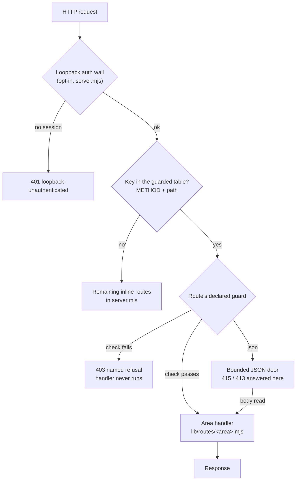

# Guarded Routes: how HTTP routes declare their boundary

Status: in use for the Mini-App routes; the remaining inline routes in `server.mjs` are being moved onto it (voicebox-beads-cwx5.1).

Every HTTP route that changes state needs a security boundary. Until this design, that boundary was a line inside each handler, and `tests/csrf-route-seam.test.mjs` proved it was still there by scanning the source text of `server.mjs`. Adding or moving a route meant editing `server.mjs` and that test by hand, which made both files merge-conflict hotspots.

A guarded route states its boundary as data, and one dispatcher enforces it.

## Adding a route

Routes live in one module per area under `lib/routes/`. A module exports a factory that returns `defineRoutes(area, [...])`:

```js
import { defineRoutes } from "./guarded.mjs";

export function createThingRoutes({ json, things }) {
  return defineRoutes("things", [
    { key: "GET /api/things", guard: "read", handler: (_req, res) => json(res, 200, things.list()) },
    {
      key: "POST /api/things",
      guard: "json",
      handler: (_req, res, _url, { body }) => json(res, 200, things.add(body)),
    },
  ]);
}
```

The host builds the area once and adds it to the dispatcher's list in `server.mjs`:

```js
const thingRoutes = createThingRoutes({ json, things });
const guardedRoutes = createGuardedDispatcher({ routes: [...miniAppRoutes, ...thingRoutes], checks, json, readJsonBody });
```

That one list entry is the only edit to `server.mjs`. Two areas never touch the same lines of a handler.

## The guards

| Guard | Who passes | What the dispatcher does |
|---|---|---|
| `read` | Anyone behind the host's auth wall | Nothing. Only allowed on `GET`, `HEAD` and `OPTIONS`. |
| `json` | A request declaring `application/json` within the size cap | Reads the body through the bounded JSON door before the handler runs and passes it as `ctx.body` (`null` if malformed). `maxBytes` on the route raises the cap for content routes. |
| `csrf` | Machine callers without browser headers, this local page, a valid host token | Refuses a browser request from any other origin with `403 cross-origin-request-refused`. For routes that cannot require a JSON content type. |
| `host-token` | A valid `x-voicebox-host-token` | Refuses everything else with `403 host-authority-required`. |
| `authority` | The host token, the room session token, or this page's own `Origin` | Refuses everything else with `403 authority-required`. |
| `room-authority` | The host token or the room session token | As `authority`, but a bare `Origin` header is not enough. |
| `wall` | Anyone behind the host's auth wall | Nothing, on a mutating route. The route must give its reason in `because`. |

## How it works



Three properties follow from the structure rather than from review:

1. **A route cannot exist without a guard.** `defineRoutes()` throws when the module is imported if a route has no guard, an unknown guard, a duplicate key, a mutating verb declared `read`, or a `wall` with no reason. The server does not start.
2. **A handler cannot forget its guard.** The dispatcher runs the check first and only then calls the handler. A `json` handler never reads the request stream itself.
3. **Moving a route changes no test.** `tests/guarded-routes.test.mjs` drives `defineRoutes()` and the dispatcher directly and asserts each area's declared guards as a table. `tests/csrf-route-seam.test.mjs` skips modules that declare guards and instead checks that each one is wired into the host's dispatcher.

## What is not covered yet

- Routes whose path contains a parameter (`/api/agents/<id>`, `/api/environments/<key>`) still live inline in `server.mjs`. The key format is an exact `METHOD /api/path`; parameters are the next step.
- The loopback auth wall and the WebSocket upgrades (`/live`, `/channel`) are separate boundaries and are unchanged. See [`18-loopback-session-auth.md`](18-loopback-session-auth.md).
